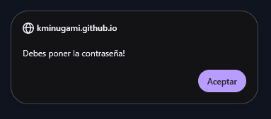
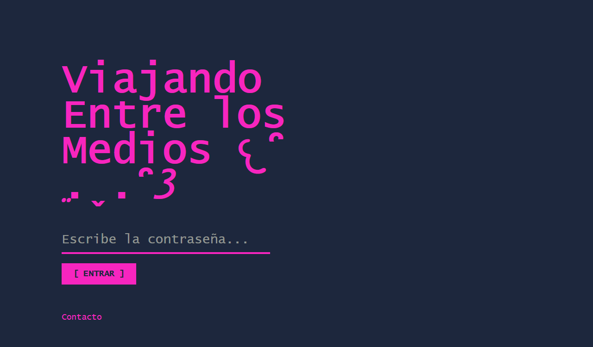
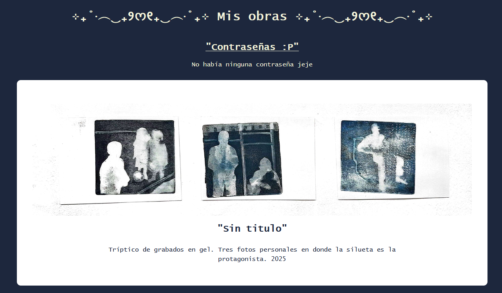

<style>
body { background: #14101f !important; }
body, p, li { color: #e8e4f0 !important; }
summary {
  cursor: pointer;
  color: #ff7ac6;
  padding: 8px 0;
}
code {
  background: #3a2f55 !important;
  color: #e8e4f0 !important;
  padding: 2px 6px;
  border-radius: 6px;
}

pre code {
  background: none !important;
  padding: 0;
}
a { color: #ff7ac6 !important; }
a:hover { color: white !important; }

pre {
  background: #1f1830 !important;
  color: #e8e4f0 !important;
  border-radius: 10px;
}

.bloque {
  background: #1f1830;
  border: 1px solid #ff7ac6;
  border-radius: 12px;
  padding: 20px;
  margin: 24px 0;
  transition: 0.3s;
}
.bloque:hover { transform: translateY(-4px); }
.bloque img { width: 100%; border-radius: 8px; }
.sin-linea { border-bottom: none !important; }
#mi-cursor { background: transparent !important; }

/* Ejercicio 5: demos */
.e5-comp { display: flex; gap: 10px; height: 200px; }
.e5-grande { flex: 3; background: #ff7ac6; border-radius: 8px; }
.e5-col { display: flex; flex-direction: column; gap: 10px; }
.e5-med { flex: 2; }
.e5-peq { flex: 1; }
.e5-col > div { flex: 1; border-radius: 8px; }

.e5-nav { display: flex; background: #333; border-radius: 8px; overflow: hidden; }
.e5-nav a { color: white !important; padding: 14px 20px; text-decoration: none; }
.e5-nav a:hover { background: red; }

.e5-side { display: flex; flex-direction: column; width: 200px; background: #333; border-radius: 8px; overflow: hidden; }
.e5-side a { color: white !important; padding: 15px; text-decoration: none; }
.e5-side a:hover { background: red; }


</style>


### Exploración creativa de arte, tecnología y medios digitales interactivos .𖥔 ݁ ˖๋ ࣭ ⭑
## Unidad I. [Hipervínculo](#unidad-i--hipervinculo-) <br> 


 1. [Mi Primera página.](#mi-primera-pagina) <br>
2. [Enlaces -  Links](#2-enlaces-links) <br> 
3. [Mini sitio / 3 páginas conectadas](#mini-sitio) <br> 
4. [css-intermedio-interacción-y-layout](#css-intermedio) <br>

## Unidad II. [Programación visual creativa basada en nodos](#programación-visual-creativa-basada-en-nodos) <br>

<div style="text-align: center; font-size: 30px; color: #801854; white-space: nowrap; overflow: hidden;">
₊˚ ✧ ‿︵‿୨୧‿︵‿ ✧ ₊˚ ₊˚ ✧ ‿︵‿୨୧‿︵‿ ✧ ₊˚ ₊˚ ✧ ‿︵‿୨୧‿︵‿ ✧ ₊˚
</div>
<h1 style="text-align: center; border-bottom: none;"><q>Unidad I</q></h1>


<h3 id="mi-primera-pagina">1. Mi primera página: <a href="https://kminugami.github.io/Multimedial/w/">https://kminugami.github.io/Multimedial/w/</a></h3>

<div class="bloque" markdown="1">

Una de las particularidades de mi página web es que exige ingresar una contraseña para acceder. En realidad, no existe una clave correcta: cualquier texto sirve, ya que el objetivo es ver qué se le ocurre escribir a cada visitante. Todo lo que ingresan queda registrado automáticamente en un formulario de Google. Eso sí, si intentan entrar sin escribir nada, aparece el siguiente mensaje:
<div style="text-align: center;">

</div>
</div>

#### Códigos de las partes que conforman la página web:
<details markdown="1">
<summary>Código de index.html</summary>

```
<!DOCTYPE html>
<html lang="es">
<head>
    <meta charset="UTF-8">
    <title>Multimedial</title>
    <style>
        body {
            background-color: #1d273d;
            color: #f725bf;
            margin: 0;
            height: 100vh;
            display: flex;
            flex-direction: column;
            justify-content: center;
            align-items: flex-start;
            padding-left: 10%;
            font-family: 'Lucida Console', Monospace;
            overflow: hidden;
        }

        .contenedor-texto p {
            font-size: 90px;
            font-weight: bold;
            margin: 0;
            line-height: 0.85;
            letter-spacing: -2px;
        }

        /* Área de entrada */
        .login-area {
            margin-top: 50px;
            display: flex;
            flex-direction: column;
            gap: 20px;
        }

        input[type="text"] {
            background: transparent;
            border: none;
            border-bottom: 4px solid #f725bf;
            color: beige;
            font-family: 'Lucida Console', Monospace;
            font-size: 28px;
            outline: none;
            width: 450px;
            padding: 10px 0;
        }

        button {
            background-color: #f725bf;
            color: #1d273d;
            border: none;
            padding: 12px 25px;
            font-family: 'Lucida Console', Monospace;
            font-size: 18px;
            font-weight: bold;
            cursor: pointer;
            width: fit-content;
            transition: 0.3s;
        }

        button:hover {
            background-color: beige;
            transform: scale(1.05);
        }

        .enlaces-bajos {
            margin-top: 60px;
            font-size: 18px;
        }

        a { color: #f725bf; text-decoration: none; }
        a:hover { text-decoration: underline; color: beige; }
    </style>
</head>

<body>

    <div class="contenedor-texto">
        <p>Viajando</p>
        <p>Entre los</p>
        <p>Medios 𐔌՞ ܸ.ˬ.՞𐦯</p>
    </div>

    <div class="login-area">
        <input type="text" id="fakePass" placeholder="Escribe la contraseña..." autocomplete="off">
        <button onclick="enviarYEntrar()">[ ENTRAR ]</button>
    </div>

    <div class="enlaces-bajos">
        <a href="contacto.html">Contacto</a>
    </div>

    <script>
        function enviarYEntrar() {
            const pass = document.getElementById('fakePass').value;
            
            if (pass.trim() === "") {
                alert("Debes poner la contraseña!");
                return;
            }

            // Configuración de tu Google Form
            const URL_FORM = "https://docs.google.com/forms/d/e/1FAIpQLScu3pfWLod5-kYDaCVIcOmsJ9LRrzBQoBrpADqswcziafUdSg/formResponse";
            const ID_ENTRADA = "entry.151227596";

            const datos = new FormData();
            datos.append(ID_ENTRADA, pass);

            // Envío y Redirección
            fetch(URL_FORM, {
                method: "POST",
                mode: "no-cors",
                body: datos
            }).then(() => {
                window.location.href = "obra.html";
            }).catch(() => {
                window.location.href = "obra.html";
            });
        }
    </script>

</body>
</html>
```

</details>
<details markdown="1">
<summary>Código de obra.html</summary>

```
<!DOCTYPE html>
<html lang="es">
<head>
    <meta charset="UTF-8">
    <title>Página 2 - Mis Obras</title>
    <style>
        /* Estilo general del cuerpo */
        body {
            font-family: 'Lucida Console', Monospace;
            background-color: #1d273d;
            color: beige;
            margin: 0;
            text-align: center; /* Centra el título principal H1 */
        }

        /* Contenedor principal */
        .contenedor {
            width: 90%; /* Aumentado un poco para dar más espacio */
            max-width: 1200px; /* Límite para que no se vea gigante en monitores grandes */
            margin: auto;
        }

        /* Sección o bloque */
        .bloque {
            background-color: white;
            margin: 30px 0;
            padding: 40px;
            border-radius: 10px;
            
            /* Flexbox para centrar todo el contenido verticalmente */
            display: flex;
            flex-direction: column;
            align-items: center; 
            justify-content: center;
        }
        .bloque-peque {
            padding: 20px !important;
            min-height: auto !important;
            height: auto !important;
            margin: 10px 0 !important;
        }

        /* Contenedor especial para cuando hay más de una imagen (Bloque 2) */
        .galeria-fotos {
            display: flex;
            flex-wrap: wrap; /* Si no caben, se ponen una abajo de otra */
            justify-content: center;
            gap: 20px; /* Espacio entre fotos */
            width: 100%;
            margin-bottom: 20px;
        }

        /* Imagen responsiva: Nunca se sale del bloque */
        .bloque img {
            max-width: 100%; /* No permite que la imagen sea más ancha que el bloque */
            height: auto; /* Mantiene la proporción */
            margin-top: 20px;
            border-radius: 4px; /* Opcional: un toque suave a las esquinas */
        }

        /* Encabezados y textos dentro del bloque blanco */
        .bloque h2 {
            margin: 20px 0 10px 0;
            color: #1d273d;
        }

        .bloque p {
            color: #1d273d;
            line-height: 1.5;
            max-width: 800px; /* Para que el texto no sea demasiado largo de leer */
        }

        /* Enlaces */
        a {
            color: #1d273d;
            text-decoration: underline;
            font-weight: bold;
        }
        
        .volver-link {
            color: beige;
            display: block;
            margin-top: 40px;
            margin-bottom: 40px;
        }


        .link-secreto {
            color: beige
            /*text-decoration: none;*/
        }

        .link-secreto:hover {
        color: #f725bf;    
        }
    </style>
</head>
<body>

    <h1>⊹₊˚‧︵‿₊୨ᰔ୧₊‿︵‧˚₊⊹ Mis obras ⊹₊˚‧︵‿₊୨ᰔ୧₊‿︵‧˚₊⊹</h1>


<h2>
    <a
href="https://docs.google.com/spreadsheets/d/10CWXhPl_xPXd1PVIt8F9eCNOif0GcTiv_oPqPXWWxvA/edit?resourcekey=&gid=1782471961#gid=1782471961"
target="_blank" class="link-secreto">
"Contraseñas :P"
    </a>
</h2>
<p> No había ninguna contraseña jeje
</p>

    <div class="contenedor">

        <div class="bloque">
            
            <h2>"Sin titulo"</h2>
            <p>
                Tríptico de grabados en gel. Tres fotos personales en donde la silueta es la protagonista. 
                2025
            </p>
        </div>

        <div class="bloque">
            <div class="galeria-fotos">
                
                
            </div>
            <h2>"Eras"</h2>
            <p>
               Dos grabados en gel. Dos personas que se dan la mano en medio de la multitud.
            </p>
        </div>

        <div class="bloque">
            
            <h2>"Abrazo"</h2>
            <p>
                Secuencia de un abrazo entre hermanas, la separación deja un vacío.
            </p>
        </div>

        <div class="bloque">
            <p>⬇⬇⬇°❀⋆ Contacto°❀⋆⬇⬇⬇</p>
            <a href="contacto.html">
                
            </a>
        </div>

        <a href="index.html" class="volver-link">Volver a la página principal</a>  
    </div>

</body>
</html>
```

</details>

<details markdown="1">
<summary>Código de contacto.html</summary>

```
<!DOCTYPE html>
<html>
<head>
<title>Contacto</title>
</head>

<body>

<h1>Contacto </h1>
<p>-inserte correo-</p>

<a href="index.html">Inicio</a><br>
<a href="obra.html">

</a>

</body>
</html>
```

</details>


### 2. Enlaces (links)
##### Ejemplos de como hacer link de una página a otra
<div class="bloque" markdown="1">

1. `<a href="pagina2.html">Ir a la página 2</a>`

Ese fragmento de código HTML sirve para crear un enlace (o link) que permite pasar de una página web a otra al hacer clic.

* `<a>` → *etiqueta de enlace.*
* `href` → *atributo que indica a qué página se va a enlazar.*
* `"pagina2.html"` → *archivo o dirección a la que se va.*
* `Ir a la página 2` → *texto visible del enlace.*
* `</a>` → *cierre de la etiqueta.*

</div>
<div style="text-align: center;">
<pre style="display: inline-block; text-align: left; background: none !important; border: none !important; overflow: visible !important; max-height: none !important; height: auto !important; font-family: 'DejaVu Sans Mono', 'Segoe UI Symbol', monospace; font-size: 18px; line-height: 1.1; letter-spacing: 0; margin: 0; padding: 0;">
⠀⠀⠀⠀⠀⠀⠀⠀⠀⠀⠀⣠⢤⡀⠀⠀⠀⠀⠀⠀⠀
⠀⠀⠀⠀⢰⠏⠳⣄⣀⣀⡸⠁⠀⠙⢆⠀⠀⠀⠀⠀⠀
⠀⠀⠀⢀⡏⠀⠀⠘⠛⠋⠃⠀⠀⠀⠸⣷⣒⣉⠀⠀⠀
⠀⠔⢒⣾⡂⠀⢴⡄⠰⣾⡖⠀⠛⠁⠀⠉⢳⡄⠀⠀⠀
⠀⠋⢹⠃⠀⠀⠀⠀⠀⠀⠀⠀⠀⢀⡀⠀⠀⢱⡄⠀⠀
⠀⢀⡏⠀⠀⠀⠀⠀⠀⠀⠀⠀⠀⠏⠟⠀⠀⠀⢱⡀⠀
⠀⡸⠁⠀⠀⠀⠐⣟⡆⠀⠀⠀⠀⠀⠀⠀⠀⠀⠈⣇⠀
⢠⡇⠀⠀⠀⠀⠀⠀⠀⠀⠀⠀⠀⠀⠀⠀⠀⠀⠀⢸⠀
⢸⠁⠀⠀⠀⠀⠀⠀⠀⠀⠀⠀⠀⠀⠀⠀⠀⠀⠀⢸⡆
⢸⠀⠀⠀⠀⠀⠀⠀⠀⠀⠀⠀⠀⠀⠀⠀⠀⠀⠀⢸⠇
⠸⡇⠀⠀⠀⠀⠀⠀⠀⠀⠀⠀⠀⠀⠀⠀⠀⠀⠀⣸⠀
⠀⠹⣄⠀⠀⠀⠀⠀⠀⠀⠀⠀⠀⠀⠀⠀⠀⠀⣰⠃⠀
⢠⠞⢉⣕⣦⣤⣐⣫⣇⣀⣀⣀⣸⣏⣣⠤⠴⠊⠁⠀⠀
⢸⡀⢸⠀⠀⠀⠀⠀⠀⠀⠀⠀⠀⠀⠀⠀⠀⠀⠀⠀⠀
⠀⠙⠋⠀⠀⠀⠀⠀⠀⠀⠀⠀⠀⠀⠀⠀⠀⠀⠀⠀⠀
</pre>
</div>

<div class="bloque" markdown="1">

2. `Ejemplo con dos páginas`

**Index**

```
<!DOCTYPE html>
<html>
<head>
<title>Mi sitio</title>
</head>

<body>

<h1>Página principal</h1>

<a href="pagina2.html">Ir a la segunda página</a>

</body>
</html>
```

**Página 2**

```
<!DOCTYPE html>
<html>
<head>
<title>Página 2</title>
</head>

<body>

<h1>Esta es la segunda página</h1>

<a href="index.html">Volver a la página principal</a>

</body>
</html>
```

- Este ejemplo muestra cómo crear una navegación básica de ida y vuelta conectando dos archivos HTML distintos: uno llamado index.html (la página principal) y otro llamado pagina2.html (la segunda página).
- En el primer archivo se muestra el encabezado "Página principal" junto con un enlace que, al hacerle clic, lleva directamente a la segunda página. A su vez, dentro del segundo archivo aparece el encabezado "Esta es la segunda página" acompañado de otro enlace que permite regresar al inicio. De esta manera, ambos documentos quedan vinculados entre sí, logrando que la persona pueda moverse libremente de una página a otra.

</div>
<div style="text-align: center;">
<pre style="display: inline-block; text-align: left; background: none !important; border: none !important; overflow: visible !important; max-height: none !important; height: auto !important; font-family: 'DejaVu Sans Mono', 'Segoe UI Symbol', monospace; font-size: 18px; line-height: 1.1; letter-spacing: 0; margin: 0; padding: 0;">
⠀⠀⠀⠀⠀⠀⠀⠀⢀⣤⢤⡀⠀⠀⠀⣠⠶⢦⡀⠀⠀⠀⠀⠀⠀
⠀⠀⠀⠀⠀⠀⠀⢀⡞⠀⠀⠙⣦⣤⣼⠃⠀⠀⠹⣄⠀⠀⠀⠀⠀
⠀⠀⠀⠀⠀⣤⣤⣏⣀⠀⠀⢀⠙⠚⡙⠀⢀⡀⠀⠹⣤⠴⠶⠀⠀
⠀⠀⠀⠀⠠⣶⡟⠒⠂⠀⠘⠟⠀⠲⠓⠀⠙⠃⠀⠀⠹⡍⠙⠀⠀
⠀⠀⠀⠀⣴⣯⡿⠀⠀⠀⠀⠀⠀⠀⠀⠀⠀⠀⠀⠀⠀⢳⠀⠀⠀
⠀⠀⢀⡾⢯⠉⠀⠀⠀⠀⠀⠀⠀⠀⠀⠀⠀⠀⠀⠀⠀⠈⣧⠀⠀
⠀⢀⡾⠿⠟⠀⠀⠀⠀⠀⠀⠀⠀⠀⠀⠀⠀⠀⠀⠀⠀⠀⢸⡄⠀
⠀⡾⠀⠀⠀⠀⠀⠀⠀⠀⠀⠀⠀⠀⠀⠀⠀⠀⠀⠀⠀⠀⠀⡇⠀
⠀⡇⠀⠀⠀⠀⠀⠀⠀⠀⠀⠀⠀⠀⠀⠀⠀⠀⠀⠀⠀⠀⠀⢧⠀
⠀⡇⠀⠀⠀⠀⠀⠀⠀⠀⠀⠀⠀⠀⠀⠀⠀⠀⠀⠀⠀⠀⠀⡼⠀
⠀⣇⠀⠀⠀⠀⠀⠀⠀⠀⠀⠀⠀⠀⠀⠀⠀⠀⠀⠀⠀⠀⢀⡇⠀
⠀⠹⡄⠀⢀⣀⠀⠀⠀⠀⠀⠀⠀⠀⠀⠀⠀⠀⠀⠀⠀⢀⡞⠀⠀
⠀⠀⠙⢦⣾⣿⠙⡖⡦⠤⣤⣄⠀⢠⡄⢦⠀⡆⢲⣀⡴⠋⠀⠀⠀
⠀⠀⠀⠀⠈⠛⠲⠿⢧⣼⣿⠾⠓⠚⠧⠼⠛⠛⠞⠁⠀⠀⠀⠀⠀
⠀⠀⠀⠀⠀⠀⠀⠀⠀⠀⠀⠀⠀⠀⠀⠀⠀⠀⠀⠀⠀⠀⠀⠀⠀
</pre>
</div>
<div class="bloque" markdown="1">

3. `<a href="https://www.wikipedia.org" target="_blank">Ir a Wikipedia</a>`

Ese fragmento de código HTML sirve para crear un enlace (o link) que dirige a una página externa y la abre en una pestaña nueva al hacer clic.

* `<a>` → *etiqueta de enlace.*
* `href` → *atributo (Hypertext Reference) que define el destino del hipervínculo, indicando al navegador la URL o archivo al que debe dirigirse.*
* `"https://www.wikipedia.org](https://www.wikipedia.org"` → *dirección web (URL) a la que se va.*
* `target="_blank` → *atributo que indica que el enlace se abrirá en una nueva pestaña.*
* `Ir a Wikipedia` → *texto visible del enlace.*
* `</a>` → *cierre de la etiqueta.*

</div>
<div style="text-align: center;">
<pre style="display: inline-block; text-align: left; background: none !important; border: none !important; overflow: visible !important; max-height: none !important; height: auto !important; font-family: 'DejaVu Sans Mono', 'Segoe UI Symbol', monospace; font-size: 18px; line-height: 1.1; letter-spacing: 0; margin: 0; padding: 0;">
⠀⠀⠀⠀⠀⠀⠀⠀⠀⠀⠀⣠⢦⢤⣀⣀⠀⠀⠀⠀⠀⠀⠀⠀⠀⠀⠀⠀⠀
⠀⠀⠀⠀⠀⠀⠀⠀⠀⠀⣸⡿⣤⣾⡏⠀⠉⢢⣤⢂⡀⠀⠀⠀⠀⠀⠀⠀⠀
⠀⠀⠀⠀⠀⠀⠀⠀⠀⢰⠁⠈⠿⠛⠃⢠⠀⠙⠚⠓⢄⠀⠀⠀⠀⠀⠀⠀⠀
⠀⠀⠀⠀⠀⠀⠀⠠⠴⣾⠀⠰⠆⠚⠂⠀⣀⡀⠀⠀⠸⣷⡄⠀⠀⠀⠀⠀⠀
⠀⠀⠀⠀⠀⠀⠀⠀⠉⢸⠀⠀⠀⠀⢀⣔⢵⡃⠀⠀⠀⠀⢾⣆⠀⠀⠀⠀⠀
⠀⣖⣖⣖⣶⣞⣶⠀⠀⢸⠀⠀⣀⡠⢫⠞⠉⠀⠀⠀⠀⠀⠀⠈⢧⠀⠀⣠⣤
⢠⠀⠀⠀⠀⠀⠀⡆⠀⢸⡀⢈⢖⡕⠁⠀⠀⠀⠀⠀⠀⠀⠀⠀⠈⡆⣴⣉⡟
⢸⠀⢠⡖⢂⡭⠭⠭⠝⢛⣻⣣⡮⠭⢍⢒⡆⠀⠀⠀⠀⠀⠀⠀⠀⣿⢹⠏⠀
⢸⠀⠨⣯⣍⣁⣒⣒⠒⠒⣒⣒⣋⣉⣩⣥⡇⠀⠀⠀⠀⠀⠀⠀⢠⠟⠁⠀⠀
⢸⣀⣀⢳⠀⠈⠉⠉⠉⠉⠉⠉⠉⠀⠀⡸⠀⠀⠀⠀⠀⠀⠀⡠⠃⠀⠀⠀⠀
⠈⣧⡴⢿⡳⣀⠀⠀⠀⠀⠀⠀⠀⢀⠴⠗⠒⠒⠒⠒⠒⠧⠞⠀⠀⠀⠀⠀⠀
⠀⠀⠀⢺⢈⡏⠑⠒⠂⠀⠐⠒⠊⠁⠀⠀⠀⠀⠀⠀⠀⠀⠀⠀⠀⠀⠀⠀⠀</pre>
</div>
<h3 id="mini-sitio">3. Mini sitio (3 páginas conectadas)</h3>
<div class="bloque" markdown="1">
Como se mostró anteriormente, realicé una página que contenía index, obras y contacto. En index se ubica el lugar destinado para colocar las contraseñas, en obras hay grabados de mi propiedad con su respectiva definición y, finalmente, en contactos deberían estar en teoría mis datos!
<div style="text-align: center;">

<br>

</div>
</div>


<h3 id="css-intermedio">4. CSS intermedio (interacción y layout)</h3>

Objetivo general

* Introducir hover (interacción)
* Entender flexbox (alineación)
* Controlar imágenes y proporciones
* Empezar a pensar en diseño más dinámico

<div class="bloque" markdown="1">

Ejercicio 1: Efecto Hover (interacción)

 * OBJETIVO → *Que los elementos reaccionen al mouse*
 * INSTRUCCIONES:
 1. Crear un botón o bloque
 2. Cambiar su color cuando el mouse pasa encima
 3. Agregar una transición suave


**Código base**
```
<style>
.boton { /* Define una clase llamada "boton" */
  background-color: blue; /* Color de fondo del botón */
  color: white; /* Color del texto */
  padding: 15px; /* Espacio interno (arriba, abajo, izquierda, derecha) */
  width: 150px; /* Ancho fijo del botón */
  text-align: center; /* Centra el texto horizontalmente */
  transition: 0.3s; /* Hace que los cambios (como color) sean suaves en 0.3 segundos */
}

.boton:hover { /* Se activa cuando el mouse pasa sobre el elemento */
  background-color: red; /* Cambia el color de fondo al pasar el mouse */
}
</style>

<a href="https://google.com" class="boton">Ir a Google</a>
```
</div>

<div class="bloque" markdown="1">

Ejercicio 2: Flexbox (alineación horizontal)

 * OBJETIVO → *Ordenar elementos en fila*
 * INSTRUCCIONES:
 1. Crear 3 bloques
 2. Alinearlos horizontalmente
 3. Separarlos de forma uniforme

**Código base**
```
<style>
.contenedor { /* Clase contenedora */
  display: flex; /* Activa flexbox: organiza los hijos en fila */
  justify-content: space-around; /* Distribuye los elementos con espacio alrededor */
}

.caja { /* Clase para cada bloque */
  background-color: lightgreen; /* Color de fondo */
  padding: 20px; /* Espacio interno */
}
</style>

<div class="contenedor"> <!-- Contenedor flex -->
  <div class="caja">1</div> <!-- Primer bloque -->
  <div class="caja">2</div> <!-- Segundo bloque -->
  <div class="caja">3</div> <!-- Tercer bloque -->
</div>
```
</div>

<div class="bloque" markdown="1">

Ejercicio 3: Flexbox (centrado total)

 * OBJETIVO → *Centrar elementos en pantalla (muy útil)*
 * INSTRUCCIONES:
 1. Centrar un elemento en el medio exacto de la pantalla (horizontal y vertical)

**Código base**
```
<style>
body { /* Aplica estilos al cuerpo completo de la página */
  display: flex; /* Activa flexbox */
  justify-content: center; /* Centra horizontalmente */
  align-items: center; /* Centra verticalmente */
  height: 100vh; /* Altura total de la pantalla (viewport height) */
}

.caja { /* Elemento que será centrado */
  background-color: black; /* Fondo negro */
  color: white; /* Texto blanco */
  padding: 30px; /* Espacio interno */
}
</style>

<div class="caja">Centro</div> <!-- Elemento centrado en pantalla -->
```
</div>

<div class="bloque" markdown="1">

Ejercicio 4:  Imágenes controladas

 * OBJETIVO → *Manejar imágenes correctamente*
 * INSTRUCCIONES:
 1. Insertar una imagen
 2. Ajustarla para que no se deforme
 3. Agregar borde y estilo

**Código base**
```
<style>
<style>
img { /* Aplica a todas las imágenes */
  width: 300px; /* Ancho fijo */
  height: 200px; /* Alto fijo */
  object-fit: cover; /* Ajusta la imagen sin deformarla (recorta si es necesario) */
  border: 5px solid black; /* Borde negro de 5px */
}
</style>

 <!-- Imagen de ejemplo -->
```
</div>

<div class="bloque" id="ejercicio-5" markdown="1">

Ejercicio 5: Composición con flex

* OBJETIVO → *Crear una composición visual tipo obra*
* INSTRUCCIONES:
    1. Crear una grilla simple usando flex
    2. Combinar distintos tamaños de bloques
    3. Usar colores como lenguaje visual
* IDEA → *1 bloque grande, 2 medianos y 3 pequeños*

<div markdown="0">
<div class="e5-comp">
  <div class="e5-grande"></div>
  <div class="e5-col e5-med">
    <div style="background:#801854;"></div>
    <div style="background:#3a2f55;"></div>
  </div>
  <div class="e5-col e5-peq">
    <div style="background:#7ad7ff;"></div>
    <div style="background:#ffd27a;"></div>
    <div style="background:#b7ff7a;"></div>
  </div>
</div>
</div>

<details markdown="1">
<summary>Ver código</summary>

```
<style>
.composicion { display: flex; gap: 10px; height: 200px; }
.grande { flex: 3; background: #ff7ac6; }
.columna { display: flex; flex-direction: column; gap: 10px; }
.medianos { flex: 2; }
.pequenos { flex: 1; }
.columna div { flex: 1; }
</style>

<div class="composicion">
  <div class="grande"></div>
  <div class="columna medianos">
    <div style="background: #801854;"></div>
    <div style="background: #3a2f55;"></div>
  </div>
  <div class="columna pequenos">
    <div style="background: #7ad7ff;"></div>
    <div style="background: #ffd27a;"></div>
    <div style="background: #b7ff7a;"></div>
  </div>
</div>
```

</details>

</div>

<div class="bloque" markdown="1">

Barras de navegación con flexbox

*Horizontal:* `display: flex` pone los links en fila.

<div markdown="0">
<div class="e5-nav">
  <a href="#ejercicio-5">Inicio</a>
  <a href="#ejercicio-5">Proyectos</a>
  <a href="#ejercicio-5">Contacto</a>
</div>
</div>

<details markdown="1">
<summary>Ver código</summary>

```
<style>
.navbar { display: flex; background-color: #333; }
.navbar a { color: white; padding: 14px 20px; text-decoration: none; }
.navbar a:hover { background-color: red; }
</style>

<div class="navbar">
  <a href="#">Inicio</a>
  <a href="#">Proyectos</a>
  <a href="#">Contacto</a>
</div>
```

</details>

*Vertical:* se agrega `flex-direction: column` y los links quedan en columna.

<div markdown="0">
<div class="e5-side">
  <a href="#ejercicio-5">Inicio</a>
  <a href="#ejercicio-5">Proyectos</a>
  <a href="#ejercicio-5">Contacto</a>
</div>
</div>

<details markdown="1">
<summary>Ver código</summary>

```
<style>
.sidebar { display: flex; flex-direction: column; width: 200px; background-color: #333; }
.sidebar a { color: white; padding: 15px; text-decoration: none; }
.sidebar a:hover { background-color: red; }
</style>

<div class="sidebar">
  <a href="#">Inicio</a>
  <a href="#">Proyectos</a>
  <a href="#">Contacto</a>
</div>
```

</details>

</div>

<div class="bloque" markdown="1">

Formas de centrar texto

**1. Horizontal con `text-align`**

<div markdown="0">
<div style="text-align: center; border: 1px solid #ff7ac6; padding: 10px;">Este texto está centrado horizontalmente</div>
</div>

<details markdown="1">
<summary>Ver código</summary>

```
<div style="text-align: center;">
  Este texto está centrado horizontalmente
</div>
```

</details>

**2. Horizontal y vertical con flexbox**

<div markdown="0">
<div style="display: flex; justify-content: center; align-items: center; height: 120px; border: 1px solid #ff7ac6;">Texto completamente centrado</div>
</div>

<details markdown="1">
<summary>Ver código</summary>

```
<div style="
  display: flex;
  justify-content: center;
  align-items: center;
  height: 120px;
  border: 1px solid #ff7ac6;
">
  Texto completamente centrado
</div>
```

* `display: flex` → activa flexbox
* `justify-content: center` → centra en horizontal
* `align-items: center` → centra en vertical
* `height` → necesario para que se note el centrado vertical

</details>

**3. Con grid**

<div markdown="0">
<div style="display: grid; place-items: center; height: 120px; border: 1px solid #ff7ac6;">Texto centrado con grid</div>
</div>

<details markdown="1">
<summary>Ver código</summary>

```
<div style="
  display: grid;
  place-items: center;
  height: 120px;
  border: 1px solid #ff7ac6;
">
  Texto centrado con grid
</div>
```

</details>

**4. Con `position` (la forma clásica)**

<div markdown="0">
<div style="position: relative; height: 120px; border: 1px solid #ff7ac6;">
  <p style="position: absolute; top: 50%; left: 50%; transform: translate(-50%, -50%); margin: 0;">Texto centrado absoluto</p>
</div>
</div>

<details markdown="1">
<summary>Ver código</summary>

```
<div style="position: relative; height: 120px; border: 1px solid #ff7ac6;">
  <p style="
    position: absolute;
    top: 50%;
    left: 50%;
    transform: translate(-50%, -50%);
  ">
    Texto centrado absoluto
  </p>
</div>
```

</details>

</div>


<div style="text-align: center; font-size: 30px; color: #801854; white-space: nowrap; overflow: hidden;">
₊˚ ✧ ‿︵‿୨୧‿︵‿ ✧ ₊˚ ₊˚ ✧ ‿︵‿୨୧‿︵‿ ✧ ₊˚ ₊˚ ✧ ‿︵‿୨୧‿︵‿ ✧ ₊˚
</div>


<h1 style="text-align: center; border-bottom: none;"><q>Unidad II</q></h1>


<script>
var cursor = document.getElementById("mi-cursor");
var escondido = false;
document.addEventListener("mousemove", function(e) {
  if (!escondido) {
    var estilo = document.createElement("style");
    estilo.innerHTML = "* { cursor: none !important; }";
    document.head.appendChild(estilo);
    cursor.style.display = "block";
    escondido = true;
  }
  cursor.style.left = e.clientX + "px";
  cursor.style.top = e.clientY + "px";
});
</script>
